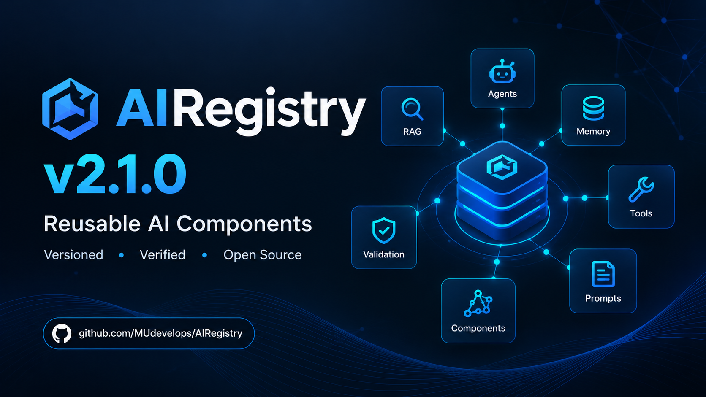
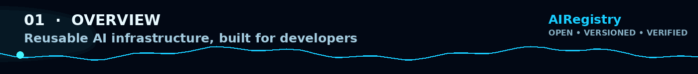
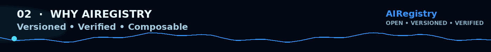
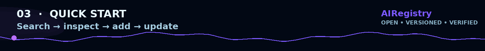
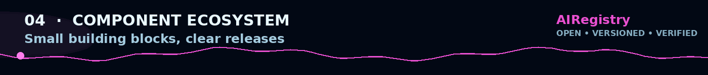
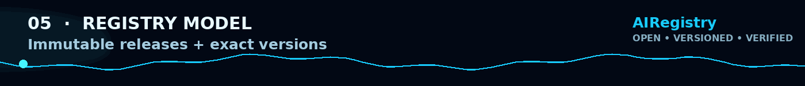
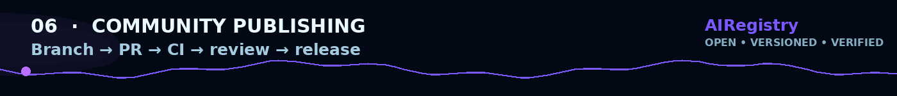
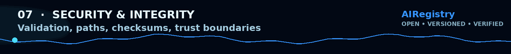
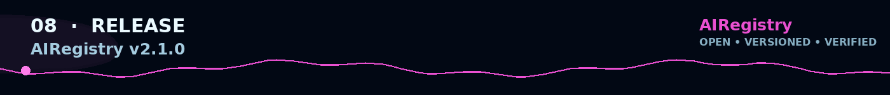
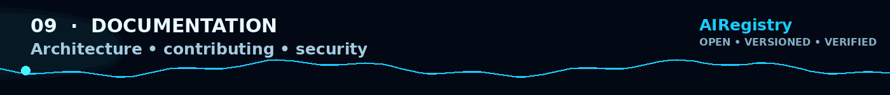

<div align="center">




<br/>

<p>
  <a href="https://github.com/MUdevelops/AIRegistry/releases/tag/v2.1.0">
    
  </a>
  <a href="https://github.com/MUdevelops/AIRegistry">
    
  </a>
  <a href="https://www.python.org/">
    =3.9"/>
  </a>
  <a href="https://airegistry.instantregret96.workers.dev">
    
  </a>
</p>

### **Install AI capabilities, not libraries.**

<p>
  AIRegistry is an open-source registry and dependency-free CLI for reusable
  AI components, workflows, tools, agents, memory, retrieval, prompts, and templates.
</p>

<p>
  <a href="https://github.com/MUdevelops/AIRegistry">GitHub</a>
  ·
  <a href="https://airegistry.instantregret96.workers.dev">Live Registry</a>
  ·
  <a href="https://github.com/MUdevelops/AIRegistry/issues">Issues</a>
  ·
  <a href="https://github.com/MUdevelops/AIRegistry/pulls">Pull Requests</a>
</p>

</div>



## ✦ What is AIRegistry?

AI development repeatedly needs the same small building blocks: retrieval, memory,
agents, citations, prompts, tools, validation, and text processing.

**AIRegistry packages those building blocks as discoverable, versioned, auditable source components.**

<div align="center">

```text
                 ┌─────────────────────┐
                 │     AIRegistry      │
                 │  versioned source   │
                 └─────────┬───────────┘
                           │
        ┌──────────────────┼──────────────────┐
        ▼                  ▼                  ▼
      Discover           Verify             Add
        │                  │                  │
        └──────────────────┼──────────────────┘
                           ▼
                     Build & Compose
```


<sub><strong>The Central Hub</strong> — reusable AI capabilities connected through one versioned registry.</sub>

</div>

> **Reuse the capability. Own the source. Pin the version.**



## ⚡ Why AIRegistry?

| Capability | What it gives developers |
|---|---|
| 🧬 **Immutable releases** | Components live under explicit version paths. |
| 🎯 **Exact resolution** | `name@version` is a first-class reference. |
| 🔐 **Integrity checks** | Release files carry SHA-256 metadata. |
| 🧱 **Composable source** | Reuse small building blocks inside your own applications. |
| 🛠️ **Dependency-free CLI** | Standard-library-first developer workflow. |
| 🤝 **Community publishing** | Contributions flow through GitHub branches and PRs. |

```text
discover
   ↓
inspect
   ↓
verify
   ↓
add
   ↓
compose
   ↓
publish
```



## 🚀 Quick Start

### Install

From a local checkout:

```powershell
python -m pip install .
```

### Search

```bash
ai search rag
```

### Inspect

```bash
ai info rag
ai info rag@0.1.0
```

### Preview

```bash
ai add rag@0.1.0 --dry-run
```

### Install

```bash
ai add rag@0.1.0
```

### Inspect local state

```bash
ai list
```

### Update

```bash
ai update
```

<div align="center">

```text
┌──────────┐     ┌────────────┐     ┌─────────┐     ┌──────────────┐
│  search  │ ──▶ │   inspect  │ ──▶ │  verify │ ──▶ │  install     │
└──────────┘     └────────────┘     └─────────┘     └──────────────┘
```

</div>



## 🧩 Component Ecosystem

AIRegistry v2.1 includes 13 reusable components:

| Component | Latest | Category | Typical role |
|---|---:|---|---|
| `agent` | `0.1.0` | agent | Tool-calling agent loop |
| `chat` | `0.1.0` | template | Minimal chat starter |
| `citation-builder` | `1.0.0` | tool | Citation and bibliography formatting |
| `citations` | `0.1.0` | tool | Numbered source citations |
| `context-builder` | `1.0.0` | retrieval | Structured, size-limited context |
| `conversation-memory` | `1.0.0` | memory | In-memory conversation store |
| `json-validator` | `1.0.0` | validation | JSON validation and schema checks |
| `keyword-rag` | `1.0.0` | retrieval | Lightweight keyword retrieval |
| `memory` | `0.1.0` | tool | JSON-file memory store |
| `prompt-builder` | `1.0.0` | prompt | Reusable prompt construction |
| `rag` | `0.1.0` | workflow | Small keyword retrieval workflow |
| `text-chunker` | `1.0.0` | text | Configurable text chunking |
| `tool-router` | `1.0.0` | tool | Safe tool registration and routing |

<div align="center">

`RAG` · `Agents` · `Memory` · `Tools` · `Prompts` · `Citations` · `Validation`

</div>



## 🔍 Registry Model

AIRegistry v2.1 uses an immutable, versioned release model:

```text
registry/
└── component/
    └── versions/
        ├── 0.1.0/
        │   ├── component.json
        │   ├── README.md
        │   └── src/
        │
        ├── 0.2.0/
        │   ├── component.json
        │   ├── README.md
        │   └── src/
        │
        └── 1.0.0/
            ├── component.json
            ├── README.md
            └── src/
```

Each release records:

- exact version metadata;
- dependency references;
- release notes;
- file list;
- SHA-256 checksums;
- immutable source path.

So:

```bash
ai add rag@0.1.0
```

is not merely "install the current RAG component"; it is an explicit release selection.



## 🤝 Community Publishing

AIRegistry is built for developer participation.

Contributors can submit:

- new components;
- new releases;
- exact dependency references;
- release notes and metadata.

The publisher workflow prepares a branch, commit, and pull request instead of writing
directly to `main`.

```text
Developer
    │
    ▼
Publisher UI
    │
    ├── manifest validation
    ├── version validation
    ├── dependency validation
    ├── path / file checks
    └── release preparation
            │
            ▼
      GitHub Pull Request
            │
         CI + Review
            │
            ▼
           main
            │
            ▼
        registry release
```

Live publisher entry point:

**https://airegistry.instantregret96.workers.dev**



## 🔐 Security & Integrity

AIRegistry treats published source as an explicit trust boundary.

```text
submission
    ↓
manifest validation
    ↓
version validation
    ↓
dependency validation
    ↓
path / file safety
    ↓
SHA-256 metadata
    ↓
PR review
    ↓
published release
```

The CLI also checks:

- unsafe/traversal paths;
- blocked executable extensions;
- release source paths;
- checksum consistency.

See [`SECURITY.md`](./SECURITY.md).



## 📦 V2.1.0 Release

**AIRegistry v2.1.0** introduced the versioned-release foundation:

- Registry schema v2.
- Immutable version directories.
- Exact component references.
- Exact dependency references.
- SHA-256 file integrity metadata.
- Version-aware lockfiles.
- `ai update`.
- Community publishing for new components and releases.
- Version history and release selection in the web interface.
- V2.0 → V2.1 migration tooling.

**Release:** `v2.1.0`  
**Commit:** `116af78`  
**Tag:** `v2.1.0`

<a href="https://github.com/MUdevelops/AIRegistry/releases/tag/v2.1.0">

</a>



## 📚 Documentation

| Document | Purpose |
|---|---|
| [`ARCHITECTURE.md`](./ARCHITECTURE.md) | System design and production architecture |
| [`CONTRIBUTING.md`](./CONTRIBUTING.md) | Contribution and publishing workflow |
| [`SECURITY.md`](./SECURITY.md) | Security model and reporting |
| [`CHANGELOG.md`](./CHANGELOG.md) | Release history |
| [`BUILD_NOTES.md`](./BUILD_NOTES.md) | Build and release notes |
| [`docs/CLOUD_AUTH.md`](./docs/CLOUD_AUTH.md) | GitHub / Cloudflare authentication details |


## 🌌 Vision

AIRegistry is intentionally modular:

**discover → understand → verify → install → compose → publish**

The direction is developer-owned AI infrastructure:

- small components;
- explicit releases;
- transparent source;
- reproducible installation;
- GitHub-native contribution.

<div align="center">

### **AIRegistry**

**Discover. Build. Share.**

<sub>Open-source infrastructure for reusable AI components.</sub>

<br/><br/>


</div>
